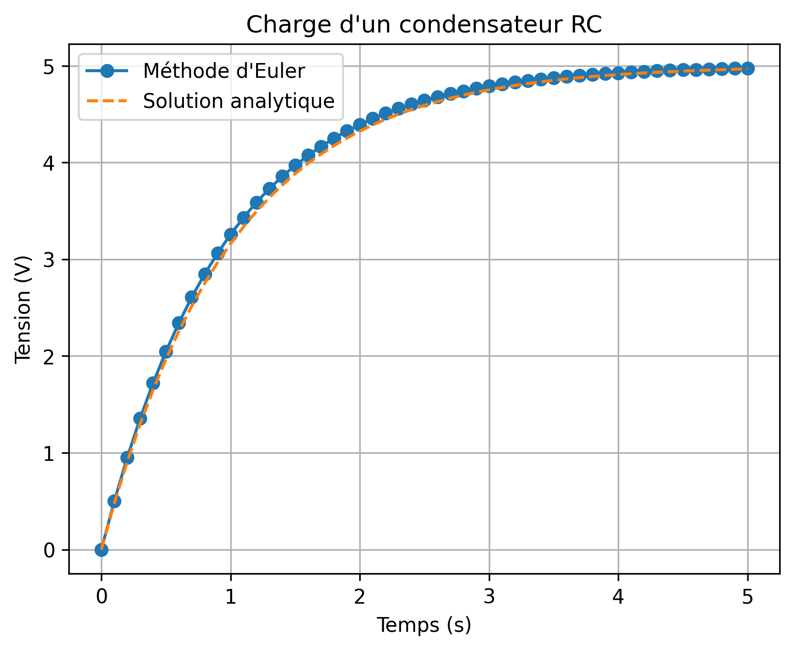

# Projet RC – Méthode d'Euler en Python

Simulation numérique de la charge d'un condensateur dans un circuit RC avec la méthode d'Euler, puis comparaison avec la solution analytique.

## Objectif

Ce projet permet de :

- modéliser la charge d'un condensateur RC ;
- résoudre numériquement l'équation différentielle avec la méthode d'Euler ;
- comparer la solution numérique à la solution analytique ;
- calculer l'erreur absolue à \(t = 1\,s\) ;
- visualiser les deux solutions sur un même graphique.

## Modèle physique

L'équation différentielle du circuit RC est :

```text
dU/dt = (E - U) / (R × C)
```

avec :

```text
E = 5 V
R = 1000 ohms
C = 0.001 F
U(0) = 0 V
```

La constante de temps vaut :

```text
tau = R × C = 1 s
```

## Méthode d'Euler

La méthode d'Euler utilise l'approximation :

```text
U[n+1] = U[n] + h × f(U[n])
```

avec :

```text
f(U) = (E - U) / (R × C)
```

et un pas de temps :

```text
h = 0.1 s
```

## Solution analytique

Comme la tension initiale vaut 0 V, la solution analytique est :

```text
U(t) = E × (1 - exp(-t / (R × C)))
```

## Comparaison

À \(t = 1\,s\), le programme compare :

- la tension obtenue par la méthode d'Euler ;
- la tension analytique ;
- l'erreur absolue entre les deux résultats.

## Résultat graphique

Le programme génère automatiquement le graphique suivant :



Le graphique montre que la solution numérique obtenue avec la méthode d'Euler suit la solution analytique.

## Concepts utilisés

- Python ;
- NumPy ;
- Matplotlib ;
- équation différentielle ;
- méthode d'Euler ;
- solution analytique ;
- erreur numérique ;
- circuit RC ;
- constante de temps.

## Organisation du projet

```text
projet_rc_euler/
├── main.py
├── charge_condensateur.png
└── README.md
```

## Remarque

Ce projet illustre l'utilisation de Python pour relier un modèle physique, une méthode numérique et une représentation graphique.